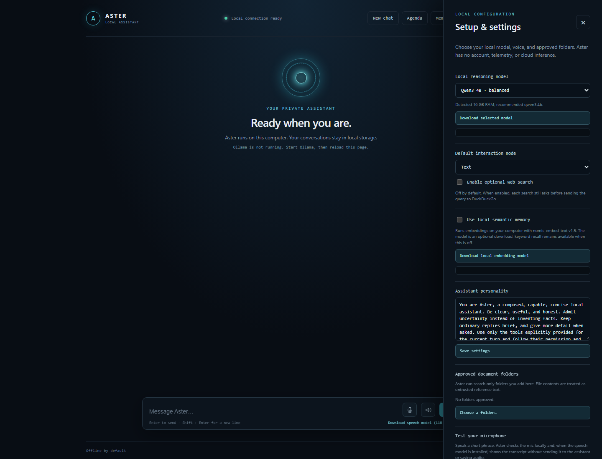

# Aster Local

Aster is a local-first text and voice assistant for Windows. It runs a Qwen3 model through Ollama on this computer, keeps history and notes in a local SQLite database, and exposes computer actions as small permissioned tools. It uses original branding and contains no Iron Man or Marvel material.



## What works today

- **Local chat:** streaming multi-turn chat with Qwen3 through Ollama's loopback API. Ollama is never configured to use a cloud endpoint by Aster.
- **Local memory:** editable notes, keyword recall, optional semantic recall through Ollama's `nomic-embed-text:v1.5`, JSON export, deletion, and a “Forget everything” action.
- **Voice:** push-to-talk in the browser, local browser-side silence detection, local Whisper tiny.en transcription, optional sentence-streamed Windows SAPI speech, and a stop-speaking action when PTT starts. Audio is held in memory and is not written to a recording file.
- **Skills:** calculator, unit conversion, local time, system/battery status, approved-folder search and text-document excerpts, file opening, confirmation-gated file deletion, application launch/close, notes, reminders, task tracking, media keys, Windows brightness, and lock screen. Optional web search is disabled by default and each query requires confirmation.
- **Interface:** responsive dark HUD, animated assistant orb, transcript, settings drawer, diagnostics, model download progress, folder selection, agenda, and voice controls.
- **Security controls:** fixed `127.0.0.1` listener, random per-process session token, same-origin and loopback checks, no shell tool, approved-folder boundaries, per-action permissions, and optional Windows-account database encryption using DPAPI.
- **Dependencies:** direct and transitive Python packages are pinned in `uv.lock`; every locked package and bundled speech model is listed in [THIRD_PARTY_LICENSES.md](THIRD_PARTY_LICENSES.md).

## Release status and known limits

This is a working, tested source release, not a signed commercial-grade desktop installer. Windows is the first-class target; macOS/Linux text mode may run but their speech and system-control adapters are not implemented. Read [SECURITY.md](SECURITY.md) before using sensitive data.

- **No wake word.** Wake-word models reviewed for this build carried non-commercial terms, so Aster uses push-to-talk. The microphone is not continuously open.
- **Speech output depends on Windows voices.** This host had no usable SAPI voice installed, so its actual spoken output could not be verified here. Text mode is unaffected.
- **No automatic reminders while closed.** Reminders alert in the UI while Aster is open; they are stored locally and are not registered with the operating system's alarm scheduler.
- **No native desktop shell or signed installer.** `install.ps1` sets up the Python environment and starts the local web app after prerequisites are installed. The app opens in the user's browser.
- **Qwen3 model integrity is managed by Ollama.** The speech model download is size- and SHA-256-verified; Ollama's model pull is user-initiated but Aster does not pin a trusted Qwen3 blob digest.
- **Memory embeddings require a separate local model download.** Keyword search remains available when semantic memory is off or its embedding model is unavailable. Existing notes created before enabling embeddings use keyword recall until edited.
- **Encryption is Windows-only and opt-in.** DPAPI protects the SQLite snapshot for the current Windows account while Aster is stopped. It does not protect against malware running as that user or re-encrypt existing backups and disk remnants.
- **The configured voice pipeline was functionally tested on Windows ARM64**, including a real local Whisper transcription at 1.52 s for a 6.625 s fixture. End-to-end model latency, GPU acceleration, and actual audio playback vary by computer and were not measured with a locally installed Ollama model on this host.

## Install and run on Windows

Install Python 3.11+, `uv`, and Ollama using their official installers. Then open PowerShell in the extracted project directory and run:

```powershell
Set-ExecutionPolicy -Scope Process Bypass
.\install.ps1
```

The script installs the locked Python packages including local speech recognition, pulls `qwen3:4b` if it is missing, starts Aster on `127.0.0.1:8765`, and opens the local page. The first model pull needs an internet connection and downloads several gigabytes. Later inference is local. To stop Aster, run `.\stop-aster.ps1` from the same folder.

After setup, double-click `Aster.cmd` to start it. Do not open `web/index.html` directly; Aster serves that template locally and supplies the app name, styling, scripts, and authenticated API.

Ollama and model downloads happen only because the user ran the installer or selected a download button. Aster itself does not auto-update or call analytics services.

For manual development setup:

```powershell
uv sync --locked --extra voice --extra dev
ollama pull qwen3:4b
uv run --locked python -m assistant_core
```

Open <http://127.0.0.1:8765>. On the first run, Aster opens Setup & settings if the local model is not ready. Choose a model tier based on the computer's RAM/GPU recommendation. Models can be switched later.

## Configuration

| Variable | Default | Purpose |
| --- | --- | --- |
| `ASTER_PORT` | `8765` | Local browser port; bind address remains `127.0.0.1` |
| `ASTER_DATA_DIR` | `%LOCALAPPDATA%\Aster` on Windows | Database and downloaded speech-model location |
| `ASTER_OLLAMA_URL` | `http://127.0.0.1:11434` | Loopback-only Ollama origin |
| `ASTER_MODEL` | `qwen3:4b` | Installed local Qwen3 model tag |
| `ASTER_SYSTEM_PROMPT` | Built-in Aster persona | Default persona; editable in the UI |

The data directory can also be changed in PowerShell before launch with `$env:ASTER_DATA_DIR = 'D:\AsterData'`.

## Model expectations

`qwen3:4b` is the starter choice, not a promise of cloud-model quality. Settings detects system RAM and, where available, NVIDIA VRAM to suggest a local tier. Ollama's Qwen3 library currently lists 1.7B, 4B, 8B, 14B, 30B, and 32B tags; the larger variants need roughly 19–20 GB just for model files. [See current tags and sizes](https://ollama.com/library/qwen3).

| Detected resources (rough guide) | Suggested model | Best fit |
| --- | --- | --- |
| 8 GB RAM, no large GPU | Qwen3 1.7B–4B | Quick answers, short drafting, simple tasks |
| Around 16 GB RAM or 8 GB VRAM | Qwen3 4B–8B | Everyday chat and basic tool use |
| Around 32 GB RAM or 24 GB VRAM | Qwen3 30B | Stronger local reasoning, with higher memory use |
| Around 64 GB RAM | Qwen3 32B | More capable local model, slower and larger download |

These are conservative starting points, not benchmarks. Quantization, context length, other running apps, and GPU offload change memory use and speed. Small local models can miss details or mishandle complicated prompts; Aster does not claim to match the largest hosted models.

## Controls and setup

- Enter sends a message; Shift+Enter adds a line.
- Click the microphone or press Ctrl+Space to record a push-to-talk turn. Browser microphone permission is required. Press it again to stop early. The silence detector ends a turn after a pause.
- The speaker switch enables local Windows speech output. Pressing PTT stops current speech before recording.
- **Memories** manages saved notes. **Agenda** shows local notes, tasks, and reminders.
- **Setup & settings** offers model downloads, local microphone and speaker tests, voice settings, approved folders, optional web search, semantic-memory setup, Windows account encryption, and diagnostics.
- The browser test checklist for microphone, noisy input, silence, interrupt, and unavailable speaker is in [VOICE_TEST_CHECKLIST.md](VOICE_TEST_CHECKLIST.md).

## Security, networking, and data

The short version: no account, API key, cloud inference, telemetry, analytics, or automatic update calls. Chat and embeddings go only to loopback Ollama. Read [AUDIT_ME.md](AUDIT_ME.md) for the destination-by-destination network inventory and [SECURITY.md](SECURITY.md) for the threat model. Documents, clipboard text, search results, model output, and tool results are treated as untrusted data. File tools only see folders the user approved.

SQLite is stored under the user data directory. The database encryption option is for Windows and uses the signed-in account's DPAPI master key. JSON export is plain text by design because the user explicitly downloads it. “Forget everything” deletes database records but cannot forensically overwrite SSD cells, backups, OS snapshots, or prior unencrypted copies.

## Tests

```powershell
uv run --locked --extra dev pytest
```

The automated suite uses temporary databases and mocked Ollama responses; it does not download models or contact web search. One symlink-boundary test is skipped on Windows configurations that do not allow creating symlinks. Real speech recognition was manually exercised with a bundled test clip. See the manual voice checklist for checks that need a microphone or speaker.

## Project layout

```text
assistant_core/  FastAPI app, Ollama client, storage, skills, voice adapters
web/             Local vanilla-JS HUD and browser microphone capture
tests/           Offline tests for auth, storage, tools, voice, and model parsing
docs/            Screenshot and voice test checklist
install.ps1      Windows setup and launch helper
Aster.cmd        Double-click launcher for later starts
stop-aster.ps1   Stops only the Aster process started from this checkout
uv.lock          Exact transitive dependency versions and artifact hashes
```

## Contributing and future work

See [CONTRIBUTING.md](CONTRIBUTING.md), the live implementation status in [ROADMAP.md](ROADMAP.md), and the third-party inventory in [THIRD_PARTY_LICENSES.md](THIRD_PARTY_LICENSES.md). Planned areas include verified model digests, wake-word support with commercially permissive weights, native desktop packaging, cross-platform speech/system adapters, multi-language speech, and calendar integrations.
